# 3. Results

## 3.1. Five-market price characteristics and experimental context

The five-market evaluation covered the DE-LU, DK1, BE, ES, and FR day-ahead bidding zones under one chronological protocol. Primary comparisons used the strict price-calendar setting (S1) and the common test mask, which contained 15,311 hourly products per market. The experts, stacking weights, conformal corrections, and event thresholds were estimated separately for each market. The evidence thus concerns procedural portability after local estimation, not transfer of fitted parameters.

The markets shared pronounced temporal dependence but differed in their price distributions (Fig. 5a-c). Lag-24 autocorrelation ranged from 0.868 to 0.925, whereas lag-168 autocorrelation ranged from 0.759 to 0.873. Negative-price incidence spanned 1.28-3.30%, and the standardized distributions separated further in their tails and rolling volatility. These descriptors establish a heterogeneous test bed without assigning forecast difficulty to any single market characteristic.

Support became markedly less balanced at the upper tail (Fig. 5d). The training-defined P95 threshold produced 45 common-mask events in DE-LU, 42 in DK1, 15 in BE, and one each in ES and FR. Central and marginal-interval comparisons retain identical, well-supported samples, whereas the ES and FR P95 ranking estimates are descriptive. Identically structured six-panel exploratory analyses for all five markets are provided in Figs. E1-E5.

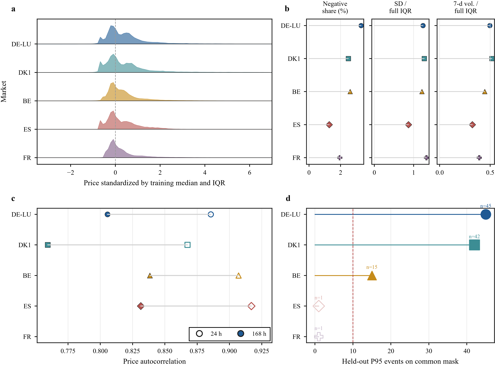

## 3.2. Central forecasting and module attribution

TSQR reduced final-test mean absolute error (MAE) relative to Persistence in every market under S1 (Fig. 6a,b). Relative reductions ranged from 3.09% in DK1 to 12.82% in DE-LU. The primary 168-h moving-block-bootstrap confidence interval excluded zero in four markets; the interval for DK1 crossed zero. The direction was more consistent across markets than either the effect size or the inferential strength.

The additional TSQR gain over stacked quantile regression (SQR) was smaller but more uniform (Fig. 6c,d). Relative MAE reductions were 0.91-2.48%, and all five 168-h confidence intervals excluded zero. Mean pinball loss also declined in each market. TSQR consequently supplied a reproducible terminal refinement, but it accounted for only a fraction of the full improvement over Persistence.

The transition atlas locates most of the central improvement earlier in the pipeline (Fig. 7). The Direct QR-to-RQR transition reduced MAE by 1.14-2.68 EUR MWh^-1, while the final SQR-to-TSQR change was 0.168-0.720 EUR MWh^-1. DK1 showed a slight RQR-to-SQR deterioration before the TSQR stage recovered the loss. Central performance is cumulative and should not be attributed to tail-aware weighting alone; the complete module atlas can move to Supplementary if the main-text figure budget is constrained.

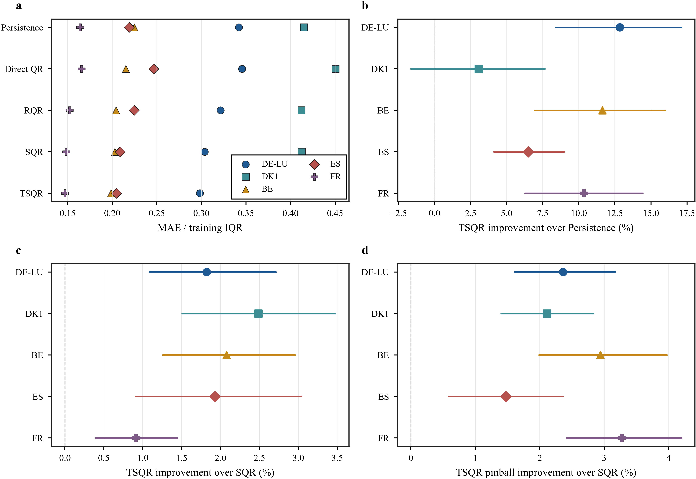

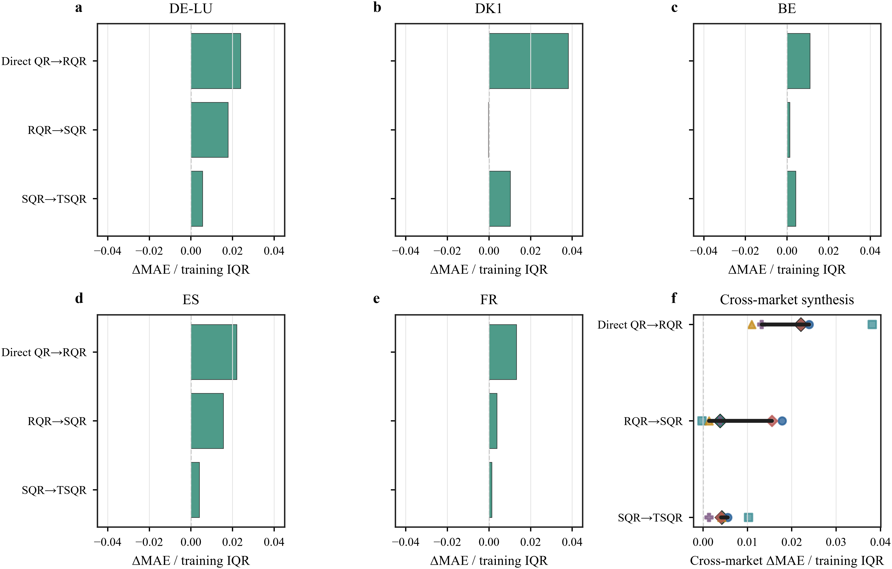

## 3.3. Marginal interval calibration and history sensitivity

Raw TSQR intervals undercovered the nominal 80% level in every market (Fig. 8a,b). PICP80 ranged from 0.578 to 0.717, corresponding to absolute coverage gaps of 0.083-0.222. The frozen W60 rolling conformalized quantile regression (RCQR) correction moved PICP80 to 0.796-0.805 and reduced the largest remaining marginal gap to 0.0045. Accurate central forecasts alone did not yield reliable raw uncertainty intervals.

The reliability correction also improved the proper interval score (Fig. 8c,d). RCQR reduced interval score by 2.80-11.87 EUR MWh^-1, with every primary 168-h confidence interval excluding zero. Mean width increased by 15.82-25.15 EUR MWh^-1. RCQR improved the reliability-sharpness balance under the interval score, but the gain carried an explicit loss of sharpness.

The same raw-to-calibrated direction persisted across the 7-, 14-, 30-, and 60-complete-day histories (Fig. 9). Coverage gap, normalized width, and normalized interval score varied by market and history length, so no single window dominated every coordinate. W60 remained the specification frozen before final-test evaluation; the window grid was not used to select a post-test optimum. The complete grid and 24-h inference sensitivity are retained in Fig. E10, and candidate Fig. 9 is supplementary-priority in the compressed architecture.

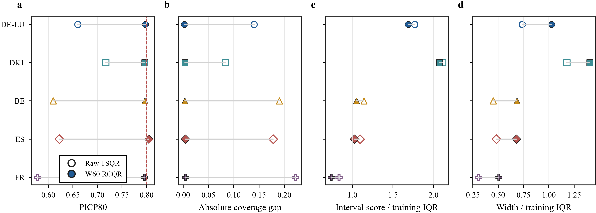

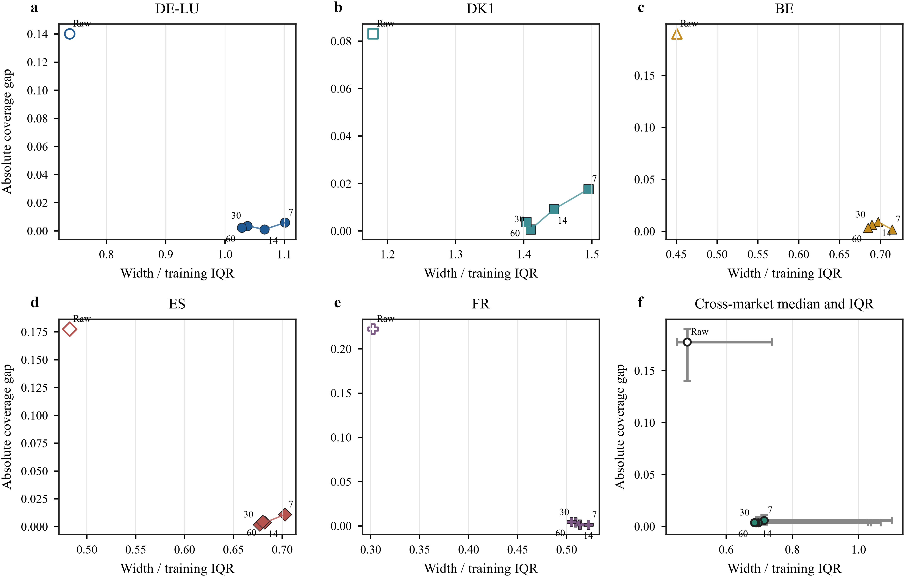

## 3.4. Information availability across markets

Archived day-ahead system forecasts added central information after local re-estimation (Fig. 10a). On the GLOBAL_COMMON mask, S2_DA reduced TSQR MAE by 7.5-26.9% relative to S1 across the five markets. The benefit was largest in DE-LU and smallest in DK1, indicating substantial but market-dependent value from archived load, wind, and solar forecasts.

Central improvement did not impose a common ordering on raw interval reliability (Fig. 10b). The raw coverage gap increased in DE-LU and DK1 but decreased in BE, ES, and FR. After W60 RCQR, the largest S2_DA absolute gap was 0.0105, and the normalized interval score was below its S1 value in every market (Fig. 10c). Richer predictors changed the conditional quantile fit without removing the need for explicit marginal calibration.

The main-text comparison is restricted to S1 and the operationally relevant S2_DA extension. S2_LEGACY remains a deterministic proxy sensitivity, whereas S3 contains realized target-hour variables and is an ex-post upper bound. Neither is mixed into the principal pair. Complete GLOBAL_COMMON and MARKET_VALID matrices are reported separately in Figs. E6 and E7, preserving the distinction between paired and setting-specific masks.

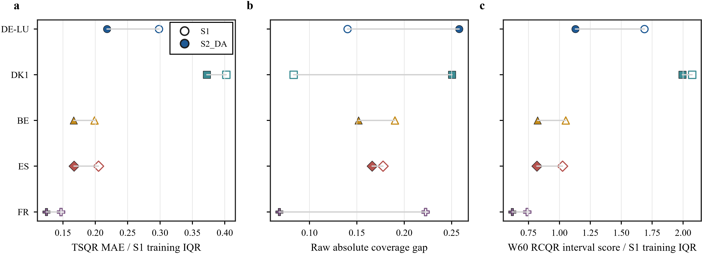

## 3.5. Temporal robustness and synchronized trajectories

Calendar slices preserved the difference between central refinement and interval calibration (Fig. 11). TSQR improved on SQR in all 10 market-year comparisons and in 17 of 20 market-season comparisons. The three seasonal reversals occurred in DK1 winter, BE winter, and ES autumn and were small. Annual agreement did not extend to invariant TSQR superiority at every calendar resolution.

RCQR showed a stronger slice-level pattern. Its interval score was lower than that of the raw interval in all 10 market-year and all 20 market-season comparisons. The magnitude changed with market and season, but none of the displayed cells reversed direction. This agreement supports marginal recalibration under temporal drift while leaving regime-specific coverage as a separate question.

The synchronized summer panels place those aggregate results on the hourly scale (Fig. 12). Each market is shown over the same calendar window fixed before cross-market error inspection, with its own vertical scale. The exact trajectories expose daily structure, local misses, and the wider RCQR envelope around the unchanged TSQR median; they are descriptive views of forecasts already included in the aggregate scores. Locked winter and spring windows appear in Figs. E8-E9. In the rolling-origin sensitivity, TSQR improved on SQR in 10 of 15 folds, whereas RCQR improved interval score in all 15 (Fig. E15).

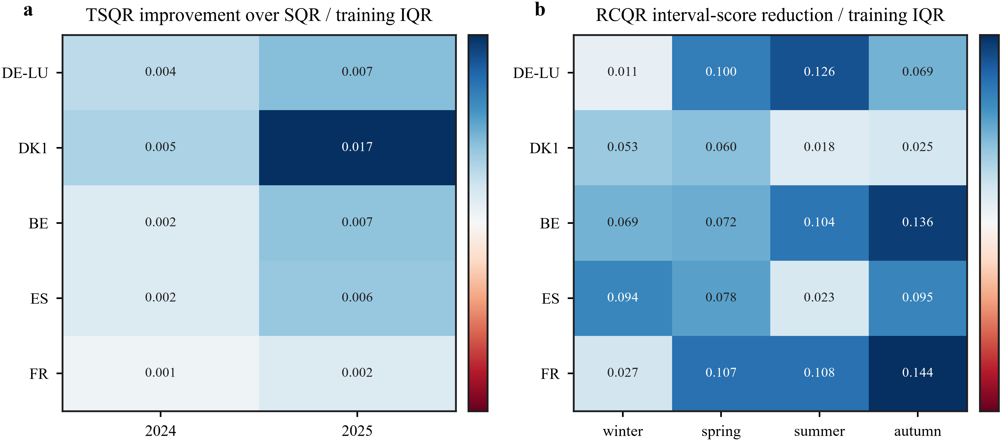

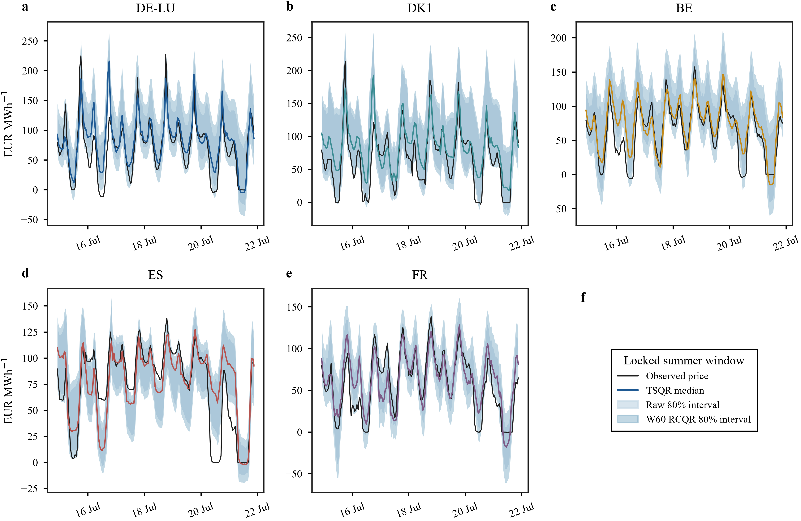

## 3.6. Conditional negative-price and upper-tail behavior

Full-sample marginal calibration did not translate uniformly to persistent negative-price states (Fig. 13). Runs lasting at least 3 h contained 730-937 evaluated products per market. RCQR raised conditional PICP80 from 0.279-0.594 to 0.440-0.927. Coverage nevertheless remained below 0.80 in DE-LU, DK1, and BE, while ES exceeded the nominal level. A common movement toward wider coverage did not produce a common endpoint.

Proper-score behavior further qualified the conditional result. RCQR reduced normalized interval score in DE-LU, DK1, BE, and FR, whereas ES showed a small increase despite its large coverage rise (Fig. 13f-j). In that market-state subset, the width penalty outweighed the reduction in misses. Marginal calibration can improve conditional uncertainty representation, but it is not a substitute for a state-specific calibration objective.

Central error rose as the training-defined upper-tail threshold became more extreme, while support contracted sharply (Fig. 14). At P99, DE-LU and DK1 retained 13 and 11 common-mask events, BE retained three, and ES and FR retained none. The frozen central-error table did not report P92.5, so that position remains blank rather than being interpolated. The most extreme points are stress diagnostics, not stable five-market comparisons, which places the conditional portability boundary well inside the full-sample result.

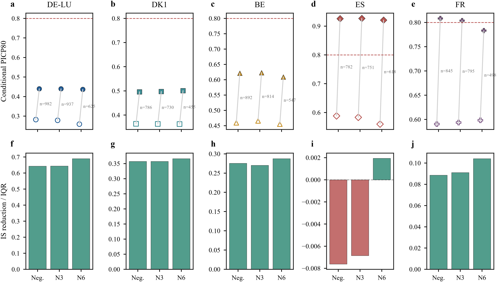

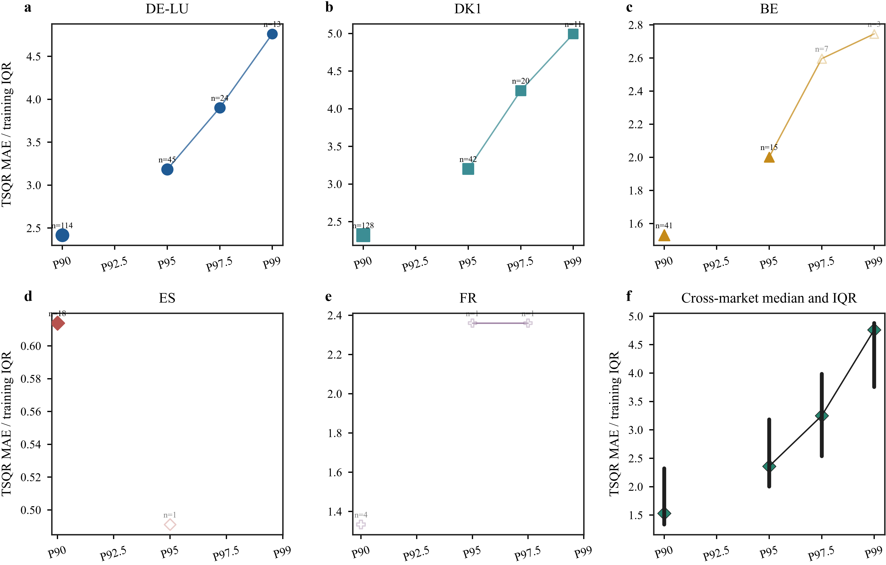

## 3.7. Upper-tail risk ranking and monitoring limits

XRM did not improve P95 ranking over the simpler TSQR q0.90 score in the three markets with interpretable test support (Fig. 15a-c). XRM area under the precision-recall curve (AUPRC) ranged from 0.064 to 0.156 in DE-LU, DK1, and BE, compared with 0.173-0.184 for q0.90. These results provide no supported ranking advantage for the dedicated classifier at the primary event definition.

Paired inference retained the same boundary (Fig. 15f). The XRM-minus-q0.90 effect was negative in DE-LU, DK1, and BE, and the 168-h confidence interval excluded zero only in DE-LU, where it favored q0.90. ES and FR each contributed one P95 event. Their displayed scores and effect estimates are consequently descriptive and cannot establish model ordering.

No formal validation segment contained the prespecified 10 P95 events required for an automatic operating point. All five threshold fields remain not estimable. Fixed review-budget recall describes retrospective capacity after ranking; it is not an alarm threshold or deployment rule. XRM is retained as a continuous research diagnostic, with full P90-P99 support and ranking sensitivity in Fig. E11 and the 0.5-5% budget summaries in Fig. E12.

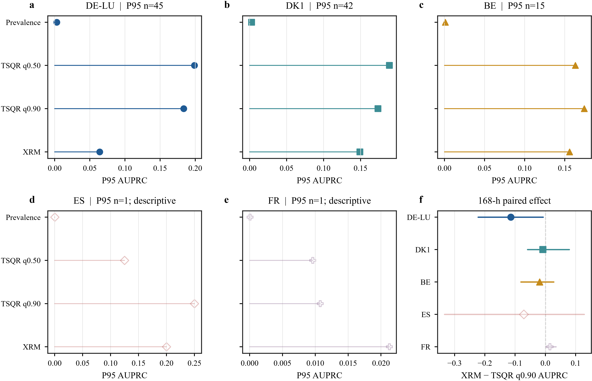

## 3.8. Operational robustness and computational profile

Predefined feature-family outages identified the fitted workflow's operational dependencies (Fig. 16a-e). Removing the 24- and 48-h price-memory family produced the largest normalized MAE deterioration in every market, spanning 0.108-0.285 training IQR. The repeated direction identifies short price memory as the input family to which the frozen workflow was most sensitive.

Other outages were smaller and more heterogeneous, and several slightly improved a held-out metric. Such reversals are compatible with redundancy among correlated predictors and finite-sample refitting effects. The perturbations should be read as fixed-workflow robustness diagnostics, not causal feature importance. Complete central, probabilistic, and XRM outage matrices are reported in Fig. E13.

Online burden was similar across the five local implementations (Fig. 16f). Median inference for 24 products required 189.1-197.9 ms, whereas XRM scoring and the RCQR daily update each required less than 0.2 ms. A single primary fit required 47.9-81.9 min, but these one-run durations are not interpreted as intrinsic market complexity. Full timing, memory, and serialized-size diagnostics appear in Fig. E14; candidate Fig. 16 remains optional for the main text.

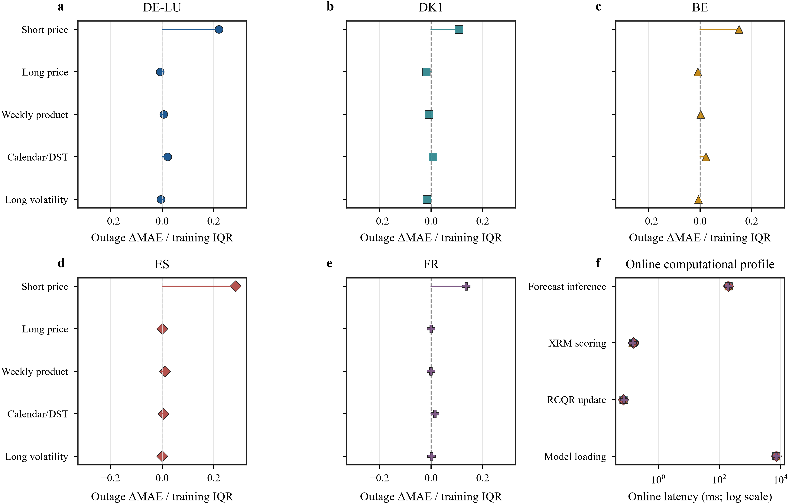

## 3.9. Integrated procedural portability

The combined evidence supports a bounded form of procedural portability across the five bidding zones (Fig. 17a,b). After local re-estimation, the full pipeline reduced terminal MAE relative to Persistence in every market, although the DK1 confidence interval was inconclusive. The additional TSQR gain over SQR was smaller but supported in all five markets. Portability applies more clearly to the shared procedure than to any common effect magnitude.

RCQR supplied the strongest cross-market component-level result (Fig. 17c,d). It reduced both the marginal coverage gap and interval score in all five aggregate comparisons, and the direction persisted across every displayed year and season. Evidence weakened as the objective became rarer or more conditional: negative-price interval scores were not uniformly improved, and XRM failed to surpass q0.90 where P95 support was interpretable (Fig. 17e).

The supported claim is procedural. A common chronology-controlled forecasting and marginal-calibration workflow can be re-estimated across the five studied European day-ahead markets. The results do not establish direct parameter transfer, universal state-conditional calibration, global market generalization, deployable performance with realized ex-post S3 information, or a validated extreme-price alarm. This evidence hierarchy provides the quantitative hand-off to the Discussion.

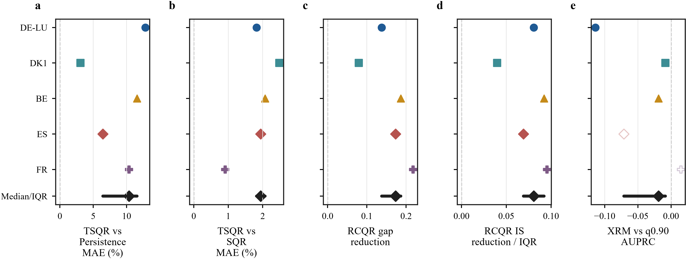
